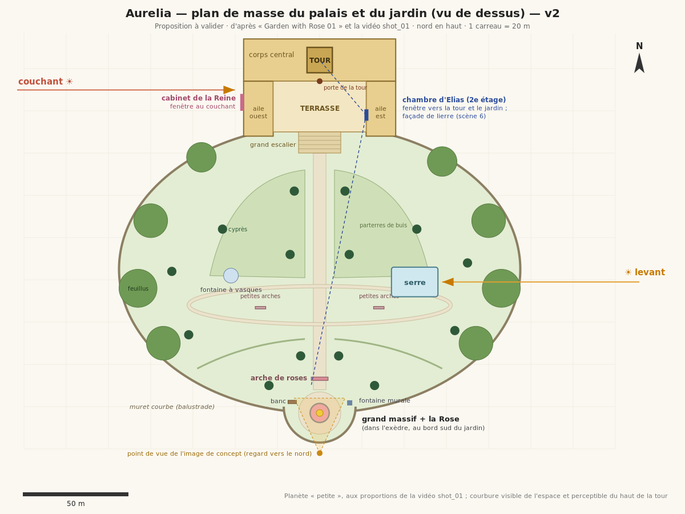

# Plan de masse d'Aurelia

Statut : décidé (2026-11-14, auteur) — v2, d'après `Import/Garden with Rose 01.png` et `Import/shot_01_tiny_kingdom.mp4` ; seul le palais en U vient de la v1.

Référence unique pour la géographie du film : la position des lieux les uns
par rapport aux autres, l'échelle et la lumière. Le blockout Blender
(`production/blender/`) et tous les cadrages en découlent.

## Échelle
- Planète **petite**, aux proportions de la vidéo `Import/shot_01_tiny_kingdom.mp4`
  (voir [aurelia.md](aurelia.md)) .

## Corrections demandées par l'auteur (2026-11-14)
- Vu en regardant le château depuis le jardin (comme sur l'image de concept) :
  **serre à droite**, fontaine murale à droite, banc et fontaine à vasques à
  gauche.
- **L'arche est entre le château et le massif.**
- **Le massif est à 100 m ou plus du château.**
- **Murets en courbes**, comme dans la vidéo, et non rectilignes.
- Palais en U conservé.

## Orientation et lumière
- Repère : le **palais est au nord**, le jardin au sud. L'image de concept est
  prise depuis le bord sud du jardin, en regardant le château (vers le nord) :
  la **serre est à droite (à l'est)**, le banc et la fontaine à vasques à
  gauche (à l'ouest).
- **Le soleil se lève à l'est, derrière la serre** ; il se couche à l'ouest
  (lumière orangée dans le cabinet de la Reine, scène 4).

## Le palais : en U, ouvert sur le jardin (au sud)
- **Corps central** au nord, avec la **tour de l'horloge** en son centre ; la
  **porte de la tour** donne sur la terrasse.
- **Terrasse** entre les deux ailes, surélevée ; un **grand escalier** descend
  vers le jardin (comme dans la vidéo).
- **Aile est** : **chambre d'Elias** au 2e étage, fenêtre sur la face
  intérieure de l'aile : elle voit la tour en biais et le jardin ; façade de
  lierre (scène 6). Côté levant.
- **Aile ouest** : **cabinet de la Reine**, fenêtre sur la façade extérieure,
  au couchant.

## Le jardin : plateau ovale, murets courbes
- Jardin ovale d'environ 190 × 135 m, bordé d'un **muret courbe** à
  balustrade (comme dans la vidéo).
- Allée centrale du grand escalier jusqu'au massif ; allée transversale en
  ellipse, avec deux **petites arches** de part et d'autre.
- Parterres de buis courbes, cyprès isolés, groupes de grands feuillus sur
  les côtés.
- **Serre** à l'est, à mi-distance ; **fontaine à vasques** à l'ouest.
- **L'arche de roses** est sur l'allée centrale, **entre le château et le
  massif**, juste avant lui.
- **Le grand massif**, avec la Rose, est au **bord sud du jardin, dans une
  exèdre** (niche semi-circulaire du muret), avec le banc à gauche et la
  fontaine murale à droite. Il est à environ **130 m de la façade** du
  palais.

## Dessin

Mesures proposées : corps central ≈ 72 × 20 m, ailes ≈ 14 × 26 m, terrasse
≈ 44 × 24 m, tour ≈ 12 × 12 m au sol, jardin ≈ 190 × 135 m, exèdre ≈ 34 m de
diamètre, massif ≈ 9 m de diamètre, serre ≈ 22 × 14 m.

## Liens
[aurelia.md](aurelia.md) · [royal-garden.md](royal-garden.md) · [palace-sets.md](palace-sets.md)
